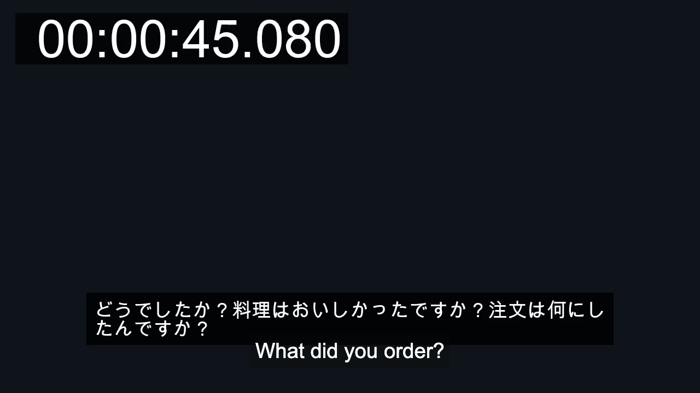
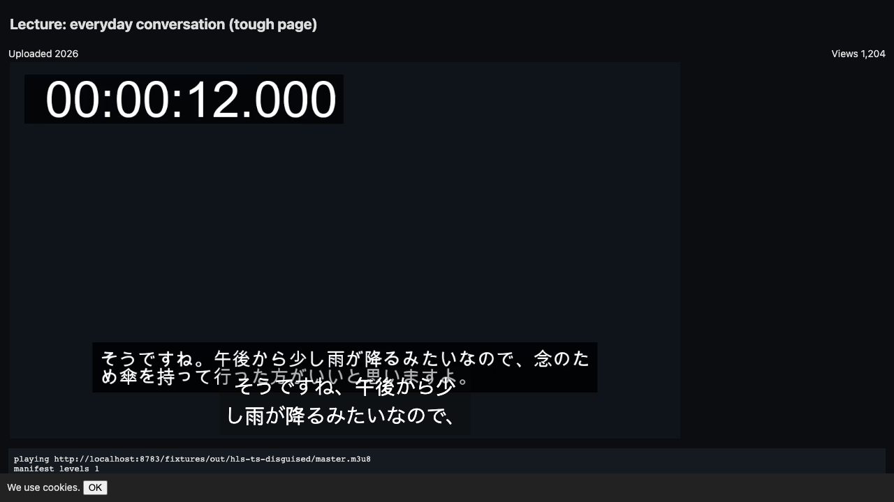
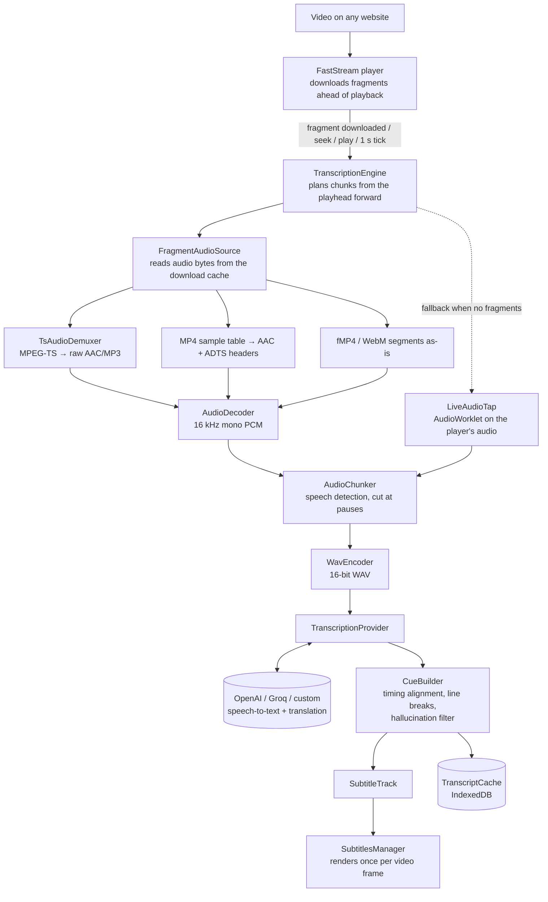

# FastStream AI Subtitles

Real-time AI subtitles for any video on the web, built into the
[FastStream](https://github.com/Andrews54757/FastStream) Chrome extension (an
open-source video player that replaces a website's player with its own).

Press **Generate subtitles (AI)** in the subtitle menu and the extension writes
subtitles with a speech-to-text API (OpenAI, Groq, or your own
OpenAI-compatible server). Optionally it translates them as well. FastStream
already downloads the video ahead of playback, so the audio is transcribed
**before** it is played. In the end-to-end tests, every line was on screen
before it was spoken.

| Japanese video, subtitles translated to English | Obfuscated test page, Japanese subtitles |
|---|---|
|  |  |

*Screenshots from the automated test run. The text at the **top** of each
frame (and the timestamp) is burned into the test video as the reference
answer. The box at the **bottom** is the AI subtitle.*

---

## What this fork adds

- **AI subtitle generation** for HLS, DASH, YouTube, Vimeo and MP4, plus a live
  capture mode for everything else (WebM, local files, plain `<video src>`).
- **Translation** of the generated lines into any language. Lines that are
  already in the target language are left alone.
- **Three providers:** OpenAI (default model `gpt-transcribe`), Groq
  (`whisper-large-v3-turbo`, configured from Groq's docs but not tested yet),
  or any OpenAI-compatible URL, e.g. a local server at `http://127.0.0.1:8080/v1`.
- **Precise timing:** OpenAI's most accurate model returns text only, with no
  timestamps. A second `whisper-1` request returns word timestamps, and the two
  transcripts are aligned so each line gets the accurate text *and* exact times.
- **Cache:** finished subtitles are saved in the browser (IndexedDB), so
  re-watching a video costs no API calls.
- **Settings page section "AI Subtitles":** API key, provider, model, spoken
  language, translation, auto-generate, lookahead, parallel requests.
- **75 unit tests** and a **Playwright end-to-end harness** that plays real
  test streams in Chromium and scores the subtitles against ground truth.

All new code lives in [`chrome/player/transcription/`](chrome/player/transcription/).
That folder's [README](chrome/player/transcription/README.md) lists every
constant and design decision.

---

## Architecture



### What each module does

| Module | Job |
|---|---|
| `TranscriptionEngine` | The scheduler. Receives player events, picks the next stretch of audio to transcribe, keeps up to N requests in flight, retries failures, and puts cues on the subtitle track. |
| `FragmentAudioSource` | Gets audio for a time range from fragments FastStream has already downloaded. Pins them so they aren't freed mid-read. |
| `TsAudioDemuxer` | Parses MPEG-TS (the container used by most HLS streams) and extracts the audio stream. It searches for the TS sync byte, so segments disguised as `.jpeg`/`.png` with a junk header still work. |
| `AudioDecoder` | Decodes with the browser's WebAudio decoder into 16 kHz mono, the format speech models expect. |
| `LiveAudioTap` + `live-tap.worklet.mjs` | Fallback: records the audio as it plays (before EQ/volume), filters and resamples it to 16 kHz, and timestamps it with the video time. |
| `AudioChunker` | Finds speech by loudness (energy in dB above the noise floor) and chooses cut points inside pauses, so no word is split between two requests. |
| `WavEncoder` | Wraps the samples in a WAV file for upload. |
| `TranscriptionProvider` | HTTP client for the speech-to-text and translation APIs: request format, timeouts, retries, error types. |
| `CueBuilder` | Turns API output into subtitle lines: aligns the text-only and timestamped transcripts, snaps line edges to where speech actually starts and ends, splits long lines (with special rules for Japanese), and drops typical Whisper hallucinations ("Thanks for watching!" over music). |
| `TranscriptCache` | Stores finished chunks in IndexedDB, keyed by video URL + duration + settings. |

Changed FastStream files: `FastStreamClient` (forwards events to the engine and
holds `play()` for the first line), `SubtitlesManager` (AI button, live track
refresh, per-frame rendering), `SubtitleTrack`, `SubtitleUtils`, the options
page, and `DefaultOptions`.

---

## Lowering latency

"Latency" here means the time between a word being spoken and its subtitle
appearing on screen. Each of these measures shortens it or hides it:

| # | Measure | Effect | Where |
|---|---|---|---|
| 1 | **Transcribe downloaded audio, not live audio.** Audio comes from fragments FastStream already prefetched, up to 120 s ahead of the playhead (capped by the player's buffer). | Subtitles are ready *before* the words are played. Pausing, seeking or changing speed doesn't matter. | `FragmentAudioSource`, `TranscriptionEngine.planNext` |
| 2 | **Short first chunk.** The chunk at the playhead is 2–6 s (target 3.5 s); chunks further ahead are 3–15 s (target 8 s). | Less audio to upload and transcribe, so the first line returns sooner. Later chunks are longer to give the model more context. | `FIRST_CHUNK`, `NEXT_CHUNK` |
| 3 | **Parallel requests.** Up to 3 chunks in flight (configurable, max 6). | The lookahead window fills several times faster than one request at a time. | `concurrency` setting |
| 4 | **Fastest accurate model as default.** `gpt-transcribe` took ~0.9 s for 8 s of audio in our 2026-10-20 test and was the most accurate on Japanese. | Short round trip per chunk. | `ProviderPresets.openai` |
| 5 | **Timing request runs in parallel, not after.** The `whisper-1` timestamp request is sent at the same moment as the text request. For the chunk at the playhead, the engine waits at most **150 ms** for it. If it is late, the line is shown with estimated timing and re-timed in place when the timestamps arrive. | Precise timing adds almost no delay where it matters. | `URGENT_TIMING_WAIT_MS`, `replaceSpanCues` |
| 6 | **Start gate.** `play()` waits up to **2.5 s** for the line at the playhead to be ready. | The first spoken word already has a subtitle instead of appearing a second late. Measured 1.5–2.5 s. | `waitUntilReady`, `START_GATE_MAX_MS` |
| 7 | **Seek handling.** On seek, in-flight requests far from the new position are aborted to free slots, and planning restarts 1 s before the new playhead immediately (0 ms delay). | After a seek, the new position is transcribed first. | `onSeek`, `SEEK_BACKOFF_SEC` |
| 8 | **Event-driven scheduling.** A downloaded fragment triggers planning within 50 ms, and a finished request triggers it at once, instead of waiting for the 1 s player tick. | No idle gaps between chunks. | `onFragmentUpdate`, `dispatch` |
| 9 | **Skip silence.** Chunks with less than 0.3 s of detected speech are never sent. | Fewer requests compete for slots; no invented text over music. | `MIN_SPEECH_SEC` |
| 10 | **Small uploads.** Audio is sent as 16 kHz mono 16-bit WAV: 32 KB per second, so an 8 s chunk is about 256 KB. | Fast upload even on slow connections, and no compression step. | `WavEncoder`, `AudioDecoder` |
| 11 | **Decode only what is needed.** For progressive MP4, the AAC frames for the time range are found in the file's sample table and given ADTS headers, so they decode without the rest of the file. The browser does the resampling in an `OfflineAudioContext`. | No need to download or decode the whole file. | `FragmentAudioSource` |
| 12 | **Call the API from the player page, not the extension's service worker.** | Avoids copying audio through Chrome's JSON messaging (which drops `ArrayBuffer`s) and avoids MV3 service workers being killed during long requests. | `TranscriptionProvider` |
| 13 | **Cache.** Finished chunks are saved in IndexedDB and loaded when the video opens. | Re-watching is instant and free. | `TranscriptCache` |
| 14 | **Per-frame rendering.** While playing, subtitles are redrawn on every video frame via `requestVideoFrameCallback` (falls back to `requestAnimationFrame`). DOM work is skipped when the visible lines haven't changed. | A line appears on the exact frame its time starts, not on the next slow UI update. | `SubtitlesManager.startRenderLoop` |
| 15 | **Skip needless translation.** Lines already in the target language (e.g. English lines in a Japanese video) are not sent to the translator. | One fewer request for mixed-language videos. | `translateCues` |
| 16 | **Live mode tuned for short lag.** Live chunks are 1.5–7 s and are sent after 0.45 s of trailing quiet (end of a sentence). | When live capture is the only option, subtitles lag by about one sentence. | `LiveAudioTap` |

---

## Results

`e2e/runner/run.mjs` plays a 204 s Japanese/English test programme (24 lines,
two music-only sections, background noise) in Chromium with the unpacked
extension, against the real OpenAI API (`gpt-transcribe` + `whisper-1`
timing). Each subtitle is compared with the exact script.

| Packaging | Lines ready before spoken | Closest call (line ready this long before speech) | Start gate | Japanese CER | English WER | Median start-time error | Lines invented over music |
|---|---|---|---|---|---|---|---|
| HLS fMP4, separate audio | 24/24 | 0.78 s | 2.2 s | 1.1% | 0% | 0.13 s | 0 |
| Progressive MP4 | 24/24 | 0.74 s | 2.0 s | 1.1% | 0% | 0.13 s | 0 |

CER / WER = character / word error rate (share of characters or words that are
wrong; lower is better). Shorter runs on HLS MPEG-TS disguised as `.jpeg`, DASH
with English translation, and an obfuscated page with auto-detection also had
every line ready before it was spoken.

**Caveat:** the test speech is macOS text-to-speech, which is much cleaner than
real recordings. Expect higher error rates on noisy or overlapping real speech.

---

## Try it

1. Clone this repo and load the `chrome/` folder in Chrome:
   `chrome://extensions` → enable **Developer mode** → **Load unpacked** →
   select `chrome/`.
2. Open FastStream's settings → **AI Subtitles**. Paste an OpenAI or Groq API
   key, or choose **Custom** and enter your server's URL.
3. Play a video in FastStream → subtitle menu → **Generate subtitles (AI)**.
   Or turn on **Auto-generate subtitles when a video has none**.

### Tests

```sh
npm install
npm test                          # 75 unit tests (node --test)
node e2e/fixtures/make-fixtures.mjs   # build test streams (needs ffmpeg + macOS `say`)
```

The e2e setup is described in [`e2e/README.md`](e2e/README.md).

---

## Privacy and cost

- **Off by default.** No audio leaves the browser unless you turn the feature on.
- When it is on, the audio is sent to the provider *you* choose, using *your*
  API key. The key is stored separately from other settings, so FastStream's
  settings export never contains it.
- You pay the provider per minute of audio. **Precise timing** sends each
  chunk twice (text model + `whisper-1`), so it roughly doubles the cost. You
  can turn it off in settings.
- DRM-protected video can't be decoded, so it can't be transcribed.

## Credits and license

Built on [FastStream](https://github.com/Andrews54757/FastStream) by Andrew S
(Andrews54757) and contributors. All player, buffering and subtitle-UI code
outside the changes above is theirs. See [LICENSE.md](LICENSE.md).
